# ambientCG: Fabric materials

**20 assets from [ambientCG](https://ambientcg.com), dedicated to the public domain under [CC0](https://docs.ambientcg.com/license/).** Use them in any game, free or paid, and change them however you like; no credit is needed.

PBR materials as 1K and 2K JPG maps (colour, normal GL and DX, roughness, AO, displacement), one folder per resolution. 713.2 MB in all.

This is a copy kept by [zuujis-cc0](https://github.com/zuujis-cc0) so game makers can take single files from GitHub. It is not made by or affiliated with ambientCG: the originals, often in more formats and higher resolutions, are on [ambientcg.com](https://ambientcg.com). If they help you, consider [supporting ambientCG](https://www.patreon.com/ambientCG).

Every file is listed in [MANIFEST.tsv](MANIFEST.tsv) with its size and SHA-256. More free assets: [the Zuujis collection](https://github.com/zuujis-cc0/free-game-assets#readme).

| | | | |
| :-: | :-: | :-: | :-: |
| <a href="Fabric072">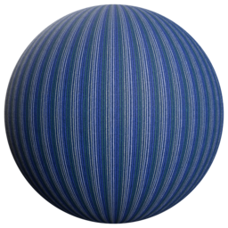</a> <b><a href="Fabric072">Fabric 072</a></b> by ambientCG · <a href="https://ambientcg.com/a/Fabric072">source</a> | <a href="Fabric073">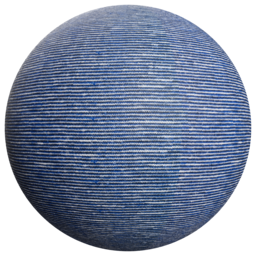</a> <b><a href="Fabric073">Fabric 073</a></b> by ambientCG · <a href="https://ambientcg.com/a/Fabric073">source</a> | <a href="Fabric074">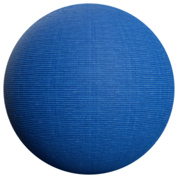</a> <b><a href="Fabric074">Fabric 074</a></b> by ambientCG · <a href="https://ambientcg.com/a/Fabric074">source</a> | <a href="Fabric075">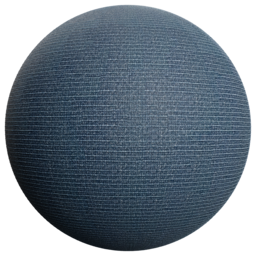</a> <b><a href="Fabric075">Fabric 075</a></b> by ambientCG · <a href="https://ambientcg.com/a/Fabric075">source</a> |
| <a href="Fabric076">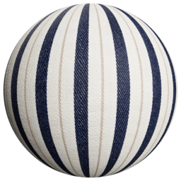</a> <b><a href="Fabric076">Fabric 076</a></b> by ambientCG · <a href="https://ambientcg.com/a/Fabric076">source</a> | <a href="Fabric077">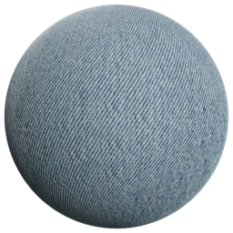</a> <b><a href="Fabric077">Fabric 077</a></b> by ambientCG · <a href="https://ambientcg.com/a/Fabric077">source</a> | <a href="Fabric078">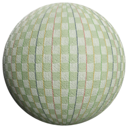</a> <b><a href="Fabric078">Fabric 078</a></b> by ambientCG · <a href="https://ambientcg.com/a/Fabric078">source</a> | <a href="Fabric079">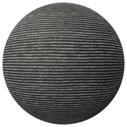</a> <b><a href="Fabric079">Fabric 079</a></b> by ambientCG · <a href="https://ambientcg.com/a/Fabric079">source</a> |
| <a href="Fabric080">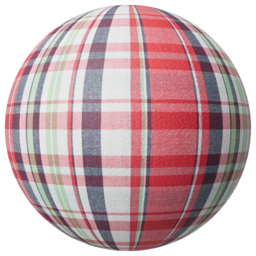</a> <b><a href="Fabric080">Fabric 080</a></b> by ambientCG · <a href="https://ambientcg.com/a/Fabric080">source</a> | <a href="Fabric081A">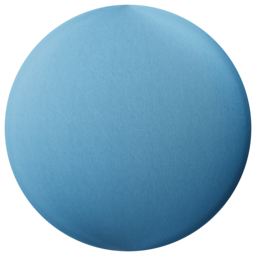</a> <b><a href="Fabric081A">Fabric 081 A</a></b> by ambientCG · <a href="https://ambientcg.com/a/Fabric081A">source</a> | <a href="Fabric081B">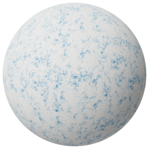</a> <b><a href="Fabric081B">Fabric 081 B</a></b> by ambientCG · <a href="https://ambientcg.com/a/Fabric081B">source</a> | <a href="Fabric081C">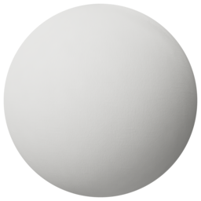</a> <b><a href="Fabric081C">Fabric 081 C</a></b> by ambientCG · <a href="https://ambientcg.com/a/Fabric081C">source</a> |
| <a href="Fabric082A">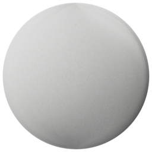</a> <b><a href="Fabric082A">Fabric 082 A</a></b> by ambientCG · <a href="https://ambientcg.com/a/Fabric082A">source</a> | <a href="Fabric082B">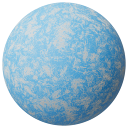</a> <b><a href="Fabric082B">Fabric 082 B</a></b> by ambientCG · <a href="https://ambientcg.com/a/Fabric082B">source</a> | <a href="Fabric082C">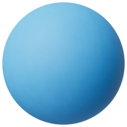</a> <b><a href="Fabric082C">Fabric 082 C</a></b> by ambientCG · <a href="https://ambientcg.com/a/Fabric082C">source</a> | <a href="Fabric083">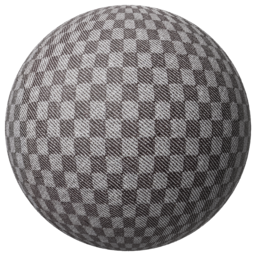</a> <b><a href="Fabric083">Fabric 083</a></b> by ambientCG · <a href="https://ambientcg.com/a/Fabric083">source</a> |
| <a href="Fabric084">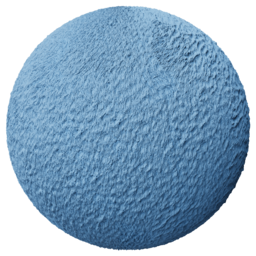</a> <b><a href="Fabric084">Fabric 084</a></b> by ambientCG · <a href="https://ambientcg.com/a/Fabric084">source</a> | <a href="Fabric085">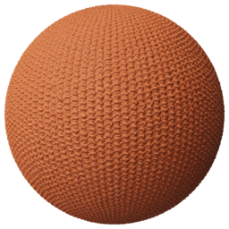</a> <b><a href="Fabric085">Fabric 085</a></b> by ambientCG · <a href="https://ambientcg.com/a/Fabric085">source</a> | <a href="Fabric086">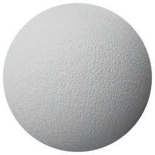</a> <b><a href="Fabric086">Fabric 086</a></b> by ambientCG · <a href="https://ambientcg.com/a/Fabric086">source</a> | <a href="Fabric087">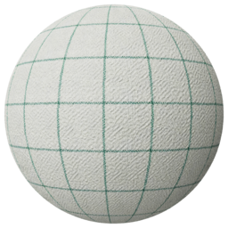</a> <b><a href="Fabric087">Fabric 087</a></b> by ambientCG · <a href="https://ambientcg.com/a/Fabric087">source</a> |

---

Kept up to date by this repository's own [update workflow](.github/workflows/update.yml), with code and plan from [cc0-mirror](https://github.com/zuujis-cc0/cc0-mirror). Something wrong? [Open an issue there](https://github.com/zuujis-cc0/cc0-mirror/issues/new) or use the [private report form](https://games.zuujis.com/report).
